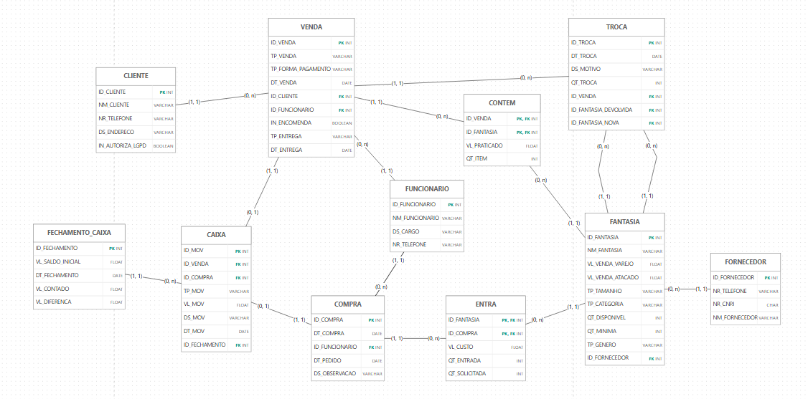

# Lolly Fantasias — Relatório Técnico Final (Entrega 2)

Modelagem e implementação do banco de dados de uma loja de fantasias do Canindé (São Paulo/SP).

| Nome completo do aluno | RGM | Usuário do GitHub |
|---|---|---|
| Rafaela Bonifacio Galvão | 48178837 | rbonifaciogalvao-sudo |
| Wilchid Vilsaint | 47443227 | wilchid1-cpu |
| Yago Lima de Queiroz | 48140597 | yagoqueiroz250-bit |

1.1 Revisão do Modelo Conceitual 
- Caracterização da organização

Nome e natureza: Lolly Fantasias, loja comercial que vende fantasias infantis e adultas, no varejo e no atacado.

Contexto e porte: 
- Loja de fantasias com fins lucrativos
- Uma unidade, com uma pessoa trabalhando atualmente (o funcionário que atende, vende, repõe e compra).
- Entre 10 e 15 vendas por dia, variando conforme o mês.
- Recebe mercadoria em média duas vezes por semana.
- Vende fantasias de categorias sazonais (Halloween, super-heróis, profissões, princesas, festa junina e outras); só as da época ficam expostas e as demais ficam em outro estoque.
- Atacado a partir de 6 peças, com valor diferenciado; entrega só em compras a partir de R$ 200.

Problemas e necessidades identificados:

- P1: Falta de controle de entrada e saída de fantasias.
- P2: Falta de controle de vendas realizadas.
- P3: Não existe registro de fechamento de caixa e fluxo de caixa.
- P4: Não existe uma forma organizada de saber a quantidade de fantasias disponíveis no estoque.

Escopo do sistema: O banco reúne os dados de toda a loja: clientes, funcionários, fornecedores, fantasias, vendas e seus itens, trocas, compras e seus itens, movimentos de caixa e fechamentos de caixa.

Justificativa da escolha:  A loja é acessível ao grupo e não possui nenhum sistema de controle, então o projeto pode propor uma solução real para estoque, vendas e fluxo de caixa. Declaração de vínculo: uma das integrantes é sobrinha do funcionário da loja. O vínculo não dispensou a entrevista presencial no local, comprovada por foto.

Evidências da organização: 

- Google Maps: https://maps.app.goo.gl/97rXVKvdabmSye7s7
- Instagram: https://www.instagram.com/lollyfantasias
- Endereço: R. Alexandrino Pedroso, 264 - Loja 16 - Canindé, São Paulo - SP, 03031-030
- Contato da loja: (11) 94708-2631
- Fotos (arquivos no repositório):
- [Foto do estabelecimento](levantamento/fotoDoEstabelecimento.jpeg)

Responsável pela organização: nome e telefone de quem atendeu o grupo — o professor pode entrar em contato para confirmar as informações.

- Leonidas Fagundes Correa - Telefone: (11) 94708-2631

Relato da entrevista 
- Quem: Leonidas Fagundes Correa, funcionário responsável por todas as tarefas da loja. Participou do grupo a integrante Rafaela.
- Quando e onde: 11/09/2026, às 13h, na própria loja (endereço acima).
- Comprovação: foto da entrevista no local ([levantamento/fachada.png]).
- Levantamento completo: [levantamento/levantamento.md](levantamento/levantamento.md), que separa o que o grupo observou na loja do que o entrevistado respondeu.

Processos de negócio 
Processos realizados pela loja

1. Atendimento ao cliente: o cliente escolhe a fantasia e o funcionário ajuda a localizar o modelo e conferir a disponibilidade.
2. Venda (varejo e atacado): o funcionário confere a disponibilidade, o cliente escolhe a forma de pagamento e paga; só depois as fantasias são separadas e entregues. A venda registra data, tipo, forma de pagamento, cliente, funcionário e, para cada item, a fantasia, a quantidade e o valor praticado.
3. Consulta e controle de estoque: contagem manual na exposição e no estoque.
4. Compra de mercadorias e escolha de fornecedores: por prazo e preço.
5. Recebimento de mercadorias: conferência manual de danos e divergências de quantidade.
6. Reposição: da exposição a partir do estoque; do estoque a partir do fornecedor, quando restam de 5 a 10 unidades.
7. Organização e identificação dos produtos: por modelo, tamanho e categoria da época, com identificação visual.
8. Encomendas: quando a quantidade pedida não existe, a loja pode encomendar ao fornecedor.
9. Definição de preços: preço de venda a partir do custo, com valor diferenciado no atacado.
10. Entrega: correio, excursão ou ônibus, para compras a partir de R$ 200.
11. Troca de produtos: troca por outra fantasia, sem devolução do valor.
12. Atendimento pós-venda: dúvidas e reclamações por WhatsApp.
13. Conservação das fantasias: guardadas em sacolas.
14. A loja emite nota fiscal.

Processos propostos pelo sistema (não existem hoje na loja): cadastro de clientes (com autorização LGPD), controle de caixa e fechamento de caixa.

Processos prováveis que ficaram de fora, com justificativa

| Processo | Por que não entrou |
|---|---|
| Produção própria de fantasias | A loja não fabrica; só compra e vende. |
| Aluguel de fantasias | A loja só vende, sem controle de locação ou devolução de peças. |
| Devolução de dinheiro | A loja só troca o produto. |
| Higienização e manutenção | Não foi identificado processo específico, só o cuidado de guardar em sacolas. |
| Cancelamento de vendas | Não foi possível confirmar como funciona; não entra enquanto não for confirmado em nova visita. |

Requisitos

Requisitos funcionais

| Código | Requisito | Problema |
|---|---|---|
| RF01 | Cadastrar cliente com nome, telefone, endereço e indicação de autorização LGPD; telefone e endereço são opcionais. | — |
| RF02 | Registrar venda sem cadastro usando o cliente padrão "Cliente não identificado". | P2 |
| RF03 | Registrar venda com data, tipo (varejo ou atacado), forma de pagamento, cliente, funcionário e indicação de encomenda e, para cada item, a fantasia, a quantidade e o valor praticado. | P2 |
| RF04 | Aplicar o valor de atacado (VL_VENDA_ATACADO) quando a venda tiver 6 peças ou mais. | P2 |
| RF05 | Registrar a entrega da venda com o meio (correio, excursão ou ônibus) e a data, somente para vendas a partir de R$ 200. | P2 |
| RF06 | Registrar troca com data, motivo, quantidade, venda de origem, fantasia devolvida e fantasia entregue no lugar. | P1, P4 |
| RF07 | Cadastrar fantasia com nome, preço de varejo, preço de atacado, tamanho, categoria, gênero, quantidade disponível, quantidade mínima e fornecedor. | P4 |
| RF08 | Atualizar a quantidade disponível a cada venda, compra e troca e permitir consultá-la a qualquer momento. | P1, P4 |
| RF09 | Listar as fantasias cuja quantidade disponível chegou à quantidade mínima, com o fornecedor e o telefone para a reposição. | P4 |
| RF10 | Cadastrar fornecedor com nome, CNPJ e telefone. | P1 |
| RF11 | Registrar compra com data do pedido, data da compra, funcionário responsável e, para cada item, a fantasia, o custo, a quantidade solicitada e a quantidade recebida. | P1 |
| RF12 | Registrar observação de danos e divergências no recebimento. | P1 |
| RF13 | Marcar uma venda como encomenda quando a fantasia foi pedida ao fornecedor para o cliente. | P1, P2 |
| RF14 | Registrar o movimento de caixa de cada venda (entrada) e de cada compra (saída), com valor, data e descrição. | P3 |
| RF15 | Registrar o fechamento de caixa com saldo inicial, data, valor contado e diferença, vinculando os movimentos conferidos. | P3 |
| RF16 | Cadastrar funcionário com nome, cargo e telefone. | P2 |
| RF17 | Emitir relatórios gerenciais: vendas e faturamento por período, fantasias mais vendidas, fluxo de caixa, estoque e reposição (consultas G01 a G19). | P1 a P4 |

- Requisitos não funcionais

| Código | Requisito |
|---|---|
| RNF01 | Integridade: o banco deve impor chaves estrangeiras, obrigatoriedade, unicidade e valores permitidos (CHECK) definidos no dicionário de dados. |
| RNF02 | Desempenho: consultas de relatório sobre o volume da loja (cerca de 12 vendas por dia) devem responder em 3 segundos; por isso há índices em datas, chaves estrangeiras e categoria. |
| RNF03 | Segurança e LGPD: acesso por papel (funcionário e responsável), dados pessoais do cliente só com autorização registrada e eliminação a pedido do titular (dicionário, seção 6). |
| RNF04 | Rastreabilidade: vendas, compras e movimentos de caixa não são apagados; o histórico permanece. |
| RNF05 | Usabilidade: como a loja tem uma só pessoa atendendo, o registro de uma venda deve ser rápido (cliente padrão e preço preenchido pela fantasia). |
| RNF06 | Disponibilidade e cópia de segurança: backup diário do banco. |
| RNF07 | Portabilidade: MySQL 8 com InnoDB e codificação utf8mb4. |

- Requisitos prováveis que ficaram de fora: controle de aluguel e devolução de peças, produção, devolução de valores e cancelamento de vendas.

- Regras de negócio

| Código | Regra | Origem |
|---|---|---|
| RN01 | A venda de atacado vale a partir de 6 peças, com valor diferenciado (VL_VENDA_ATACADO). | Entrevista |
| RN02 | A entrega só vale para compras a partir de R$ 200, por correio, excursão ou ônibus. | Entrevista |
| RN03 | As fantasias só são separadas depois da confirmação do pagamento. | Entrevista |
| RN04 | A troca é por outra fantasia, sem devolução do valor pago. | Entrevista |
| RN05 | Toda venda tem um cliente; a venda sem cadastro usa o cliente padrão "Cliente não identificado". | Proposta do sistema |
| RN06 | Os dados pessoais do cliente só são usados com autorização registrada (IN_AUTORIZA_LGPD). | Proposta do sistema |
| RN07 | A reposição é pedida ao fornecedor quando QT_DISPONIVEL chega a QT_MINIMA (de 5 a 10 unidades). | Entrevista |
| RN08 | Cada fantasia tem um único fornecedor. | Modelo |
| RN09 | A quantidade recebida pode diferir da pedida; danos e divergências são conferidos e anotados. | Entrevista |
| RN10 | O preço de venda é definido a partir do custo. | Entrevista |
| RN11 | Sem a quantidade pedida, a loja pode encomendar ao fornecedor. | Entrevista |
| RN12 | Cada fantasia tem uma categoria da época, e só as da época ficam expostas. | Entrevista |
| RN13 | Um movimento de caixa vem de uma venda ou de uma compra, nunca das duas. | Proposta do sistema |
| RN14 | O fechamento confere os movimentos; a diferença é o valor contado menos o esperado. | Proposta do sistema |

- Regras prováveis que ficaram de fora: regra de cancelamento de venda (não confirmada), prazo legal de troca, idade mínima (não se aplica a fantasias).
Modelo Lógico Relacional 

Notação e software do DER

- O DER foi criado no **brModelo**, na notação pedida (entidades, losangos, cardinalidades (mín, máx), círculos de atributos e identificadores preenchidos, sem chaves estrangeiras). Arquivo: [diagrama/der_conceitual.png](diagrama/der_conceitual.png).

- O DER tem 9 entidades (CLIENTE, FUNCIONARIO, FORNECEDOR, FANTASIA, VENDA, TROCA, COMPRA, CAIXA, FECHAMENTO_CAIXA) e 12 relacionamentos (EFETUA, REALIZA, CONTEM, REFERE, RECEBE, DEVOLVE, RESPONSAVEL, ENTRA, FORNECE, REGISTRA, GERA, CONFERE). CONTEM e ENTRA são relacionamentos N:N com atributos próprios.

- Apontamentos da correção da Entrega 1 (Caso A: mesma organização)

| Apontamento da correção da E1 | O que mudou no trabalho | Por quê |
|---|---|---|
| Remover ITEM_VENDA do DER. | ITEM_VENDA saiu; VENDA e FANTASIA se ligam pelo relacionamento CONTEM, com QT_ITEM e VL_PRATICADO. | O item é o próprio relacionamento N:N entre venda e fantasia, não uma entidade à parte. |
| Identificador da venda e cardinalidade do cliente. | VENDA tem ID_VENDA e CLIENTE participa de EFETUA com (1,1) do lado da venda. | Toda venda tem exatamente um cliente (RN05). |
| Quantidade e valor unitário da parte de compra. | QT_SOLICITADA, QT_ENTRADA e VL_CUSTO ficaram no relacionamento ENTRA, entre COMPRA e FANTASIA. | Quantidade e custo dependem do par compra + fantasia. A compra é a mercadoria fornecida para a loja. |
| Não ligar o caixa (fechamento) ao funcionário. | CAIXA e FECHAMENTO_CAIXA não se ligam a FUNCIONARIO. | Não há regra da loja que exija registrar quem fechou o caixa. |
| Não ligar o fornecedor à compra. | FORNECEDOR liga-se somente a FANTASIA (relacionamento FORNECE). | Cada fantasia tem um único fornecedor (RN08); o fornecedor de uma compra sai da fantasia comprada. |
| Nomes e prefixos dos atributos e relacionamentos. | Atributos com ID_, NM_, DT_, DS_, NR_, QT_, VL_, TP_, IN_ e relacionamentos com nome. | Padronização do dicionário de dados. |
| Trocas de produtos (processo confirmado depois). | Entidade TROCA, ligada à venda e duas vezes à fantasia (DEVOLVE e RECEBE). | A loja troca o produto e a troca precisa guardar a fantasia devolvida e a entregue (RN04). |

---

 1.2 Conversão do Modelo Conceitual para o Modelo Lógico

- Entidades → tabelas. Cada uma das 9 entidades virou uma tabela com o mesmo nome. Os dois relacionamentos N:N (CONTEM e ENTRA) viraram tabelas associativas, o que dá 11 tabelas.
- Atributos → colunas. Cada atributo virou uma coluna com tipo definido: ID_ em INT, NM_ e DS_ em VARCHAR, DT_ em DATE, QT_ em INT, VL_ em DECIMAL(10,2) no MySQL (o brModelo só tem FLOAT), IN_ em BOOLEAN, NR_CNPJ em CHAR(14).
- Relacionamentos → chaves.

| Relacionamento | Cardinalidade | Como virou chave |
|---|---|---|
| EFETUA (CLIENTE–VENDA) | 1:N | VENDA.ID_CLIENTE (FK) |
| REALIZA (FUNCIONARIO–VENDA) | 1:N | VENDA.ID_FUNCIONARIO (FK) |
| CONTEM (VENDA–FANTASIA) | N:N | tabela CONTEM, PK (ID_VENDA, ID_FANTASIA), com VL_PRATICADO e QT_ITEM |
| REFERE (VENDA–TROCA) | 1:N | TROCA.ID_VENDA (FK) |
| DEVOLVE e RECEBE (TROCA–FANTASIA) | N:1 duas vezes | TROCA.ID_FANTASIA_DEVOLVIDA e TROCA.ID_FANTASIA_NOVA (FK) |
| RESPONSAVEL (FUNCIONARIO–COMPRA) | 1:N | COMPRA.ID_FUNCIONARIO (FK) |
| ENTRA (COMPRA–FANTASIA) | N:N | tabela ENTRA, PK (ID_COMPRA, ID_FANTASIA), com VL_CUSTO, QT_SOLICITADA e QT_ENTRADA |
| FORNECE (FORNECEDOR–FANTASIA) | 1:N | FANTASIA.ID_FORNECEDOR (FK) |
| REGISTRA (VENDA–CAIXA) | 1:1 opcional | CAIXA.ID_VENDA (FK, UNIQUE, opcional) |
| GERA (COMPRA–CAIXA) | 1:1 opcional | CAIXA.ID_COMPRA (FK, UNIQUE, opcional) |
| CONFERE (FECHAMENTO_CAIXA–CAIXA) | 1:N | CAIXA.ID_FECHAMENTO (FK, opcional até o movimento ser conferido) |

- Generalização/especialização: o DER não tem; nenhuma estratégia de conversão foi necessária.
- Modelo lógico: [diagrama/modelo_logico.png](diagrama/modelo_logico.png), criado no brModelo.

- 1.3 Chaves primárias e estrangeiras

| Tabela | Chave primária | Chaves estrangeiras |
|---|---|---|
| CLIENTE | ID_CLIENTE | — |
| FUNCIONARIO | ID_FUNCIONARIO | — |
| FORNECEDOR | ID_FORNECEDOR | — |
| FANTASIA | ID_FANTASIA | ID_FORNECEDOR → FORNECEDOR |
| VENDA | ID_VENDA | ID_CLIENTE → CLIENTE; ID_FUNCIONARIO → FUNCIONARIO |
| CONTEM | (ID_VENDA, ID_FANTASIA) | ID_VENDA → VENDA; ID_FANTASIA → FANTASIA |
| TROCA | ID_TROCA | ID_VENDA → VENDA; ID_FANTASIA_DEVOLVIDA → FANTASIA; ID_FANTASIA_NOVA → FANTASIA |
| COMPRA | ID_COMPRA | ID_FUNCIONARIO → FUNCIONARIO |
| ENTRA | (ID_COMPRA, ID_FANTASIA) | ID_COMPRA → COMPRA; ID_FANTASIA → FANTASIA |
| FECHAMENTO_CAIXA | ID_FECHAMENTO | — |
| CAIXA | ID_MOV | ID_VENDA → VENDA; ID_COMPRA → COMPRA; ID_FECHAMENTO → FECHAMENTO_CAIXA |

- 1.4 Processo de normalização

| Forma normal | O que foi verificado | O que foi feito no modelo |
|---|---|---|
| 1FN | Atributos atômicos e sem grupos repetitivos. | Uma venda tem várias fantasias e uma compra também. Esses grupos repetitivos não ficam em VENDA nem em COMPRA: viraram as tabelas CONTEM e ENTRA, com uma linha por fantasia. Os demais atributos têm um valor por coluna (um telefone, um valor). |
| 2FN | Dependência parcial da chave primária composta. | As únicas chaves compostas são as de CONTEM (ID_VENDA + ID_FANTASIA) e ENTRA (ID_COMPRA + ID_FANTASIA). QT_ITEM e VL_PRATICADO dependem do par inteiro; QT_SOLICITADA, QT_ENTRADA e VL_CUSTO também. Nome, categoria e preço de tabela ficam só em FANTASIA. |
| 3FN | Dependência transitiva entre atributos que não são chave. | Dados do fornecedor (nome, CNPJ, telefone) dependem de ID_FORNECEDOR e não de ID_FANTASIA; ficam em FORNECEDOR e FANTASIA guarda só a FK. Dados de cliente e funcionário ficam em CLIENTE e FUNCIONARIO, e VENDA e COMPRA guardam só as FKs. |

Decisões sobre valores calculáveis

- QT_DISPONIVEL (FANTASIA) poderia ser calculado (entradas − vendas ± trocas). Foi mantido de propósito para saber o estoque na hora (P4) sem somar o histórico; é uma redundância controlada, atualizada a cada venda, compra e troca, e conferida pela consulta de auditoria A11.
- VL_DIFERENCA (FECHAMENTO_CAIXA) é guardado, porque o fechamento registra o que foi contado e a diferença apurada no dia; a consulta A10 confere se ele bate com (contado − esperado).
- Total da venda e total da compra não são guardados, pois saem da soma dos itens (CONTEM e ENTRA).

Por que cada forma normal foi necessária: sem a 1FN, uma venda com 3 fantasias exigiria colunas repetidas (fantasia1, fantasia2...); sem a 2FN, o preço e o nome da fantasia seriam repetidos em cada item e poderiam divergir; sem a 3FN, mudar o telefone de um fornecedor exigiria alterar todas as fantasias dele.

- 1.5 Justificativas técnicas das decisões

Chaves primárias. Foram usados identificadores sintéticos inteiros (ID_ com AUTO_INCREMENT) porque a loja não tem códigos nas fantasias e os dados naturais (nome, telefone) não são únicos nem estáveis. Em CONTEM e ENTRA a chave é composta pelas duas FKs, o que impede a mesma fantasia aparecer duas vezes na mesma venda ou compra.

Chaves estrangeiras. Cada FK implementa um relacionamento do DER (tabela da seção 1.2). Todas usam o comportamento padrão (RESTRICT): vendas, compras e movimentos não podem ficar sem o registro de origem, o que preserva o histórico (RNF04).

Restrições e as regras que implementam

| Restrição | Regra |
|---|---|
| VENDA.TP_VENDA somente `varejo` ou `atacado` | RN01 |
| FANTASIA.VL_VENDA_ATACADO > 0 e ≤ VL_VENDA_VAREJO | RN01, RN10 |
| VENDA.TP_ENTREGA somente `correio`, `excursao` ou `onibus`; TP_ENTREGA e DT_ENTREGA preenchidos juntos; DT_ENTREGA ≥ DT_VENDA | RN02 |
| VENDA.ID_CLIENTE obrigatório (cliente padrão no cadastro 1) | RN05 |
| CLIENTE.IN_AUTORIZA_LGPD obrigatório, padrão 0 | RN06 |
| FANTASIA.QT_DISPONIVEL ≥ 0, QT_MINIMA ≥ 0 (padrão 5) | RN07 |
| FANTASIA.ID_FORNECEDOR obrigatório | RN08 |
| ENTRA.QT_ENTRADA ≥ 0 e separada de QT_SOLICITADA; COMPRA.DS_OBSERVACAO opcional | RN09 |
| CHECK de valores monetários maiores que 0 | RN10 |
| VENDA.IN_ENCOMENDA obrigatório, padrão 0 | RN11 |
| FANTASIA.TP_CATEGORIA obrigatório | RN12 |
| CAIXA: exatamente uma origem (ID_VENDA ou ID_COMPRA), cada uma com UNIQUE; TP_MOV somente `entrada` ou `saida`; VL_MOV > 0 | RN13 |
| FECHAMENTO_CAIXA.VL_DIFERENCA pode ser negativa; CAIXA.ID_FECHAMENTO opcional até a conferência | RN14 |
| TROCA: fantasia devolvida diferente da fantasia nova | RN04 |
| NR_CNPJ único com 14 dígitos; telefones só com dígitos | integridade dos cadastros |

As regras que cruzam tabelas (RN01 quanto ao número de peças, RN02 quanto ao valor de R$ 200, RN04, RN07, RN09, RN13 e RN14 quanto aos totais) não cabem em CHECK do MySQL e são verificadas pelas consultas de auditoria A01 a A11.

- Decisões arquiteturais gerais

- Cliente padrão: a loja vende sem exigir dados, mas a regra RN05 diz que toda venda tem cliente; por isso existe o cliente 1, "Cliente não identificado", em vez de deixar ID_CLIENTE nulo.
- CAIXA com duas FKs opcionais: em vez de duas tabelas de movimento, um só caixa guarda entradas (vendas) e saídas (compras), com CHECK garantindo uma única origem.
- VL_ em DECIMAL(10,2): o brModelo só oferece FLOAT, mas o script usa DECIMAL para não ter erro de arredondamento em dinheiro.
- TROCA como entidade própria: guarda a fantasia devolvida e a entregue, sem campo de valor devolvido, porque a loja não devolve dinheiro (RN04).
- Quantidade solicitada x recebida: separadas em ENTRA para tornar visível a divergência com o fornecedor (RN09), que hoje a loja precisa provar manualmente.

- 1.6 Proposta de arquitetura analítica para BI e IA

Informações estratégicas. Quais fantasias vendem mais e em que época; quanto cada categoria rende; quais modelos estão acabando; quanto a loja ganha por peça; quanto entra e sai do caixa; quais fornecedores entregam menos do que o combinado; quantos clientes compram sem cadastro.

KPIs propostos (cada um tem consulta no script)

| KPI | Fórmula | Período | Meta | Consulta |
|---|---|---|---|---|
| Ticket médio | faturamento ÷ número de vendas | mês | a definir com o responsável | G03 |
| Vendas por dia | número de vendas ÷ dias com venda | mês | 10 a 15 (volume informado pela loja) | G04 |
| Fantasias mais vendidas | peças vendidas por fantasia (ranking) | período | — | G05 |
| Participação de cada forma de pagamento | valor por forma ÷ faturamento | período | — | G06 |
| Faturamento varejo x atacado | soma dos itens por tipo de venda | período | — | G07 |
| Vendas por categoria | peças e valor por categoria e mês | mês | — | G08 |
| Saldo de caixa | entradas − saídas (acumulado) | dia | saldo nunca negativo | G09 |
| % de fechamentos com diferença | fechamentos com VL_DIFERENCA ≠ 0 ÷ fechamentos | semana | 0% | G10 |
| Fantasias abaixo do mínimo | contagem de QT_DISPONIVEL ≤ QT_MINIMA | dia | 0 | G12 |
| Valor do estoque ao custo | QT_DISPONIVEL × custo médio | dia | — | G13 |
| Taxa de troca | trocas ÷ vendas | mês | a definir | G14 |
| Margem bruta | (preço de varejo − custo médio) ÷ preço de varejo | por fantasia | a definir | G15 |
| % de vendas sem cadastro | vendas do cliente 1 ÷ vendas | período | a definir | G16 |
| Taxa de divergência no recebimento | (pedido − recebido) ÷ pedido | período | 0% | G02 |
| Vendas com entrega e encomendas | contagem e valor médio | período | — | G18, G19 |

Rastreabilidade (problemas e KPIs → tabelas → consultas)

| Problema ou KPI | Tabelas envolvidas | Consulta no script |
|---|---|---|
| P1 — controle de entrada e saída de fantasias | FANTASIA, ENTRA, COMPRA, CONTEM, VENDA | G01, G02 |
| P2 — controle das vendas realizadas | VENDA, CONTEM, FANTASIA, CLIENTE | G03, G04, G05, G06, G07, G08, G14 |
| P3 — fechamento e fluxo de caixa | CAIXA, FECHAMENTO_CAIXA, VENDA, COMPRA | G09, G10, G11 |
| P4 — quantidade de fantasias disponíveis | FANTASIA, FORNECEDOR, ENTRA | G12, G13 |
| Margem bruta | FANTASIA, ENTRA | G15 |
| % de vendas sem cadastro e clientes sem compra | CLIENTE, VENDA | G16, G17 |
| Entregas e encomendas | VENDA, CONTEM | G18, G19 |

Potencial para BI. O modelo estrela é natural: VENDA + CONTEM como fato de vendas (dimensões: data, fantasia, categoria, cliente, funcionário, forma de pagamento) e COMPRA + ENTRA como fato de compras (dimensões: data, fantasia, fornecedor). Um painel (Power BI, Metabase ou Looker Studio) pode mostrar faturamento por mês e categoria, ranking de fantasias, saldo de caixa e lista de reposição, lendo diretamente as consultas G.

Aplicações de IA e análise preditiva. Previsão de demanda por fantasia e categoria usando o histórico de vendas e a sazonalidade (G08); sugestão automática de quantidade e data de reposição conforme a demanda e o prazo do fornecedor; recomendação de fantasias complementares (market basket) a partir dos itens vendidos juntos; detecção de anomalias em fechamento de caixa (A10) e em estoque (A11).

---

- 2. Modelo lógico relacional

Diagrama: [diagrama/modelo_logico.png](diagrama/modelo_logico.png), feito no brModelo (notação do modelo lógico), com 11 tabelas, colunas e tipos, PK, FK e cardinalidades. As restrições NOT NULL, UNIQUE, CHECK e DEFAULT estão no [dicionário de dados](docs/dicionario_de_dados.html) e no script.

- 3. Script SQL completo

Arquivo: [docs/script.sql](docs/script.sql), para MySQL 8.0.16 ou superior. Para executar do zero, rode o arquivo inteiro (ele apaga e recria o banco `lolly_fantasias`). Ordem dentro do arquivo:

1. `CREATE DATABASE` e `USE`
2. `CREATE TABLE` das 11 tabelas, com PK, FK, NOT NULL, UNIQUE, CHECK e DEFAULT, mais os índices do dicionário
3. `INSERT INTO` da massa de dados
4. `SELECT` com `JOIN` (S01 a S03)
5. `UPDATE` (U01) e `DELETE` (D01), dentro de transação com `ROLLBACK`, para não alterar a massa
6. Consultas gerenciais G01 a G19
7. Consultas de auditoria A01 a A11

Cada consulta G e A tem cabeçalho com código, pergunta em português e o problema (Px) ou a regra (RNxx) que atende.

- 4. Massa de dados

Dados 100% fictícios (nomes, telefones, CNPJs e valores), gerados para o período de 14/09/2026 a 07/11/2026 (oito semanas), coerente com os volumes da loja. O arquivo está no próprio `docs/script.sql`.

| Tabela | Registros | Justificativa pelo volume real da loja |
|---|---|---|
| VENDA | 565 | 10 a 15 vendas por dia em 48 dias de funcionamento (segunda a sábado), com média de 10,6 em setembro, 12,8 em outubro (mês de Halloween) e 10,2 em novembro (G04). |
| CONTEM | 873 | Cerca de 1,5 fantasia diferente por venda e 1.906 peças vendidas no total, com 71 vendas de atacado (6 peças ou mais). |
| FANTASIA | 48 | Catálogo fictício de 48 modelos em 6 categorias (Halloween, super-heróis, profissões, princesas, festa junina e carnaval). |
| COMPRA | 52 | 5 compras do estoque inicial e 47 recebimentos em 15 dias (cerca de 2 por semana, como a loja informou). |
| ENTRA | 100 | Um a vários itens por compra, divididos por fornecedor. |
| FORNECEDOR | 5 | Fornecedores escolhidos por prazo e preço, com prazos de 2 a 5 dias. |
| CLIENTE | 131 | Cliente padrão + 130 cadastrados; 299 das 565 vendas (cerca de 53%) são sem cadastro, como a loja vende hoje. Há 32 clientes cadastrados sem compra. |
| FUNCIONARIO | 2 | O responsável da loja e uma vendedora temporária (pico de outubro). |
| TROCA | 20 | Cerca de 3,5% das vendas. |
| CAIXA | 617 | Um movimento por venda (entrada) e um por compra (saída). |
| FECHAMENTO_CAIXA | 8 | Fechamentos semanais de 12/09 a 31/10; a última semana fica sem fechamento para a consulta G11. |

Situações cobertas: vendas sem cadastro, clientes sem compras, atacado e varejo, quatro formas de pagamento, entregas por correio, excursão e ônibus, 7 encomendas, trocas, divergências de recebimento, fantasias abaixo do mínimo e sem estoque, fechamentos com e sem diferença, meses diferentes.

Inconsistências propositais (uma por consulta de auditoria, para a demonstração):

| Consulta | O que foi plantado |
|---|---|
| A01 | Venda 131 marcada como atacado com 4 peças. |
| A02 | Venda 251 com um item vendido abaixo do preço de tabela. |
| A03 | Venda 331 com entrega abaixo de R$ 200. |
| A04 | Troca 4 com fantasia que não estava na venda. |
| A05 | Cliente 61 com telefone e sem autorização LGPD. |
| A06 | Fantasias na quantidade mínima ou abaixo, sem pedido de reposição registrado nos 7 dias finais (situação natural do fim da massa). |
| A07 | Compra 17 com quantidade recebida menor que a pedida e sem observação. |
| A08 | Nenhuma: retorna vazio porque todo movimento tem origem e tipo coerentes. |
| A09 | Movimento de caixa 324 com valor R$ 10,00 menor que o total da venda. |
| A10 | Fechamento 4 com diferença registrada diferente de (contado − esperado). |
| A11 | Fantasia 8 com contagem registrada 2 peças acima do histórico. |

O uso de IA para gerar a massa está documentado na seção 6.

- 6 USO DE INTELIGÊNCIA ARTIFICIAL

Durante o desenvolvimento do projeto de banco de dados da empresa Lolly Fantasias, foram utilizadas as ferramentas ChatGPT (OpenAI) e Claude (Anthropic) como apoio em diferentes etapas do trabalho. As ferramentas auxiliaram na organização das informações, na estruturação da documentação e na revisão textual.

A seguir, são apresentados os registros dos principais usos, conforme os critérios solicitados.

- 6.1. ChatGPT – Organização do levantamento de informações e processos

| Item | Registro |
|---|---|
| Ferramenta e etapa | ChatGPT (OpenAI) – organização do levantamento de informações, processos e regras de negócio da Lolly Fantasias. |
| Motivação | Organizar as informações obtidas durante a entrevista e a visita técnica, facilitando a identificação dos processos realizados pela empresa e a elaboração da documentação. |
| Prompt(s) utilizados | “Organize as informações desta entrevista em tópicos, mantendo os detalhes apresentados e separando os processos realizados pela empresa.” |
| Resposta recebida | A ferramenta apresentou uma organização das informações em tópicos, separando aspectos como vendas, estoque, fornecedores, compras, entregas e trocas. |
| Fontes consultadas e verificadas | As informações foram verificadas com base na entrevista realizada com o funcionário da Lolly Fantasias e nas observações feitas durante a visita técnica. |
| Trechos rejeitados ou corrigidos | Algumas informações foram ajustadas quando não correspondiam exatamente ao funcionamento da empresa. Situações que não foram confirmadas durante a entrevista não foram tratadas como regras definitivas. |
| Justificativa da escolha final | Foram mantidas as informações que correspondiam ao relato do funcionário e às observações realizadas, pois representavam melhor a realidade da empresa. |
| Reflexão crítica | A ferramenta ajudou na organização do conteúdo, mas não tinha conhecimento direto sobre a rotina da loja. Por isso, foi necessário conferir as sugestões para evitar a inclusão de processos ou regras que não existiam na empresa. |

- 6.2. Claude – Levantamento, dicionário de dados e documentação (README)

| Item | Registro |
|---|---|
| Ferramenta e etapa | Claude (Anthropic) – organização do levantamento da Entrega 2, estruturação do dicionário de dados e do README. |
| Motivação | Separar corretamente o que foi observado durante a visita do que o funcionário informou na entrevista, além de organizar a documentação conforme o esqueleto fornecido pelo professor. |
| Prompt(s) utilizados | “Estou confusa sobre separar o que observamos do que o entrevistado disse no levantamento. Me ajude a organizar.” / “Com base no esqueleto do professor, organize o README e o dicionário de dados.” |
| Resposta recebida | A ferramenta sugeriu a separação entre observações e entrevista, a organização das regras de negócio, dos requisitos e dos problemas identificados, além da estruturação do dicionário de dados. |
| Fontes consultadas e verificadas | O conteúdo foi conferido com as respostas do funcionário, com as informações registradas durante a visita e com o modelo de documentação da disciplina. |
| Trechos rejeitados ou corrigidos | Itens que não foram confirmados na entrevista, como o cancelamento de vendas, não foram tratados como regras definitivas. Cadastro de clientes, caixa e fechamento de caixa foram descritos como propostas do sistema, e não como processos que já existem na loja. |
| Justificativa da escolha final | Foram mantidas as informações que correspondiam ao relato e às observações, diferenciando claramente o funcionamento atual da loja das funcionalidades propostas para o sistema. |
| Reflexão crítica | A ferramenta pode misturar o que existe na empresa com o que seria desejável no sistema ou completar lacunas com suposições. Foi necessário revisar cada informação para manter a fidelidade à realidade da Lolly Fantasias. |

- 6.3. Considerações finais sobre o uso da inteligência artificial

O ChatGPT e o Claude foram utilizados como ferramentas de apoio durante o desenvolvimento do projeto, contribuindo para organizar informações e melhorar a documentação.

Entretanto, as respostas não foram consideradas automaticamente corretas. As sugestões precisaram ser analisadas e verificadas de acordo com as informações obtidas na visita técnica, os conteúdos estudados na disciplina e as orientações fornecidas pelo professor.

A utilização da inteligência artificial não substituiu a análise das informações nem as decisões tomadas durante o desenvolvimento do trabalho. Seu uso contribuiu como recurso complementar para o aprendizado e para a execução das atividades, sendo necessário manter uma postura crítica e responsável diante das respostas fornecidas.

